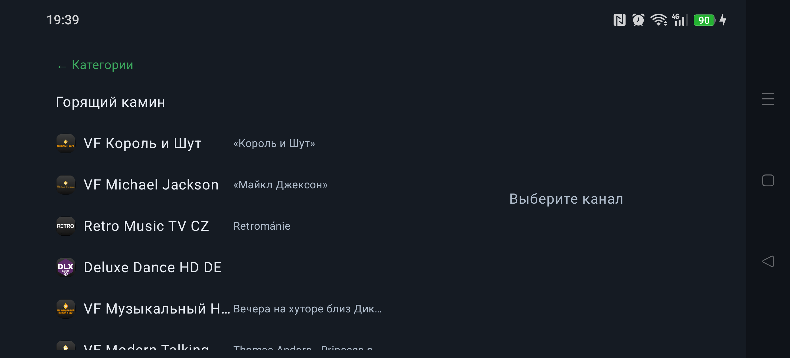
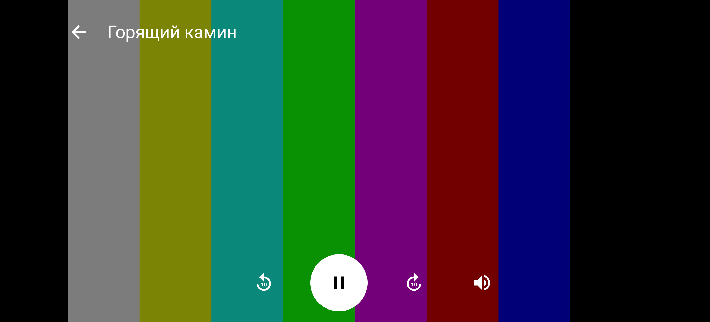
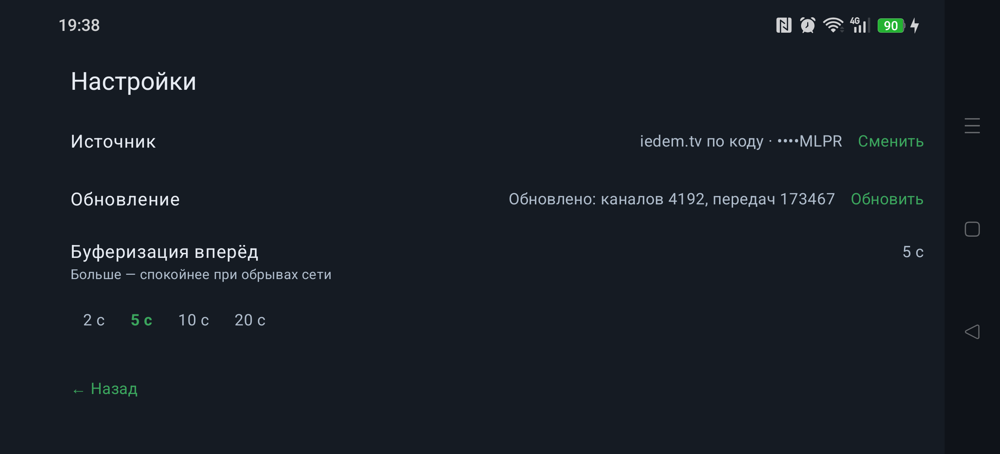

# Смотришка ТВ

**SmotrishkaTV** — домашний IPTV-клиент для Android TV и телефона: ваши каналы, программа передач
и архив в одном приложении. Один APK на оба устройства: на телевизоре — пультом, на телефоне —
пальцем.

> Личное приложение для семьи. Не публикуется в магазинах, ставится вручную по APK.

## Что умеет

- **Подключение источника** — ссылка на плейлист, код iedem.tv, логин Xtream
  или файл плейлиста с телефона.
- **Каналы по категориям** — экран из двух областей: слева категории, по нажатию на категорию
  там же открывается список её каналов (возврат — «← Категории» или «назад»), справа превью
  выбранного канала: логотип, «сейчас/далее» и кнопка «Смотреть».
- **Только альбомная ориентация** — одна раскладка на телевизор и телефон: рейл категорий слева,
  список каналов и превью справа; портретного режима нет.
- **Программа передач** — лента по времени, чтобы видеть, что идёт и что будет.
- **Архив** — прошедшие передачи можно смотреть заново, если канал отдаёт архив.
- **Обновление само** — каталог и программа обновляются при запуске и далее раз в 6 часов,
  только при наличии сети.
- **Воспроизведение** — полноэкранный плеер (Media3/ExoPlayer, HLS): название канала в OSD
  и кнопка «Назад»; «назад» возвращает к списку каналов с превью игравшего канала,
  ещё раз «назад» — к категориям.
- **Звук на любых каналах** — AC-3/E-AC-3 декодируются встроенным FFmpeg-декодером (телефоны
  обычно не умеют их аппаратно), язык дорожки настраивается: русская по умолчанию.
- **Коды и пароли под защитой** — шифруются ключом из Android Keystore, на диске их нет в открытом виде.
- **Понимает реальные плейлисты** — разные кодировки (UTF-8, cp1251), gzip, заголовки потоков,
  провайдерские варианты архива.

## Как это выглядит

Категории слева и живое превью справа → категория открывает список каналов строками (маленький
логотип, название и текущая передача) → канал играет на весь экран, OSD по касанию: название,
передача и обычные кнопки плеера → «назад» возвращает к списку с превью, ещё раз — к категориям.

> **Скриншоты устарели.** Снимки ниже сделаны на телефоне до последних правок интерфейса
> (фокус, телепрограмма в карточке, архив без программы). Новые снимки с приставки Android TV
> будут добавлены позже.







Больше снимков — в [docs/screenshots](docs/screenshots).

## Что дальше

- Экран программы канала (лента передач и архив).
- Переключение каналов вверх/вниз внутри плеера без выхода к списку.
- Превью-ряд на домашнем экране лаунчера Android TV.

## Собрать и установить

Нужны JDK 21 и Android SDK (platform 37, build-tools 36).

```bash
export JAVA_HOME=/home/mops1k/.local/share/dsh-jetbrains/jdk-21
export ANDROID_HOME=/home/mops1k/Android/Sdk

./gradlew :app:assembleDebug
# APK появится после сборки: app/build/outputs/apk/debug/app-debug.apk
```

Установка на подключённое устройство (Windows-adb из WSL, порт 5038):

```bash
cd /mnt/c/Users/Kvintilyanov/Desktop/platform-tools
./adb.exe -P 5038 install -r <путь-к-собранному-apk>
./adb.exe -P 5038 shell am start -n com.mops1k.smotrishka.tv/.MainActivity
```

## Подробности

- [docs/specification.md](docs/specification.md) — что именно делает приложение по каждому экрану
  и правилу (для разработки и приёмки).
- [docs/iedem-by-code.md](docs/iedem-by-code.md) — как работает подключение по коду iedem.tv:
  запросы, адреса, подстановка ключа, поток, архив, программа передач и ошибки.
- [AGENTS.md](AGENTS.md) — правила работы над проектом.
- [План работ и решения по этапам](.dsh/plans/smotrishka-iptv-klient-dlya-android-tv-i-android.md) —
  как проект развивался и почему приняты текущие решения.
