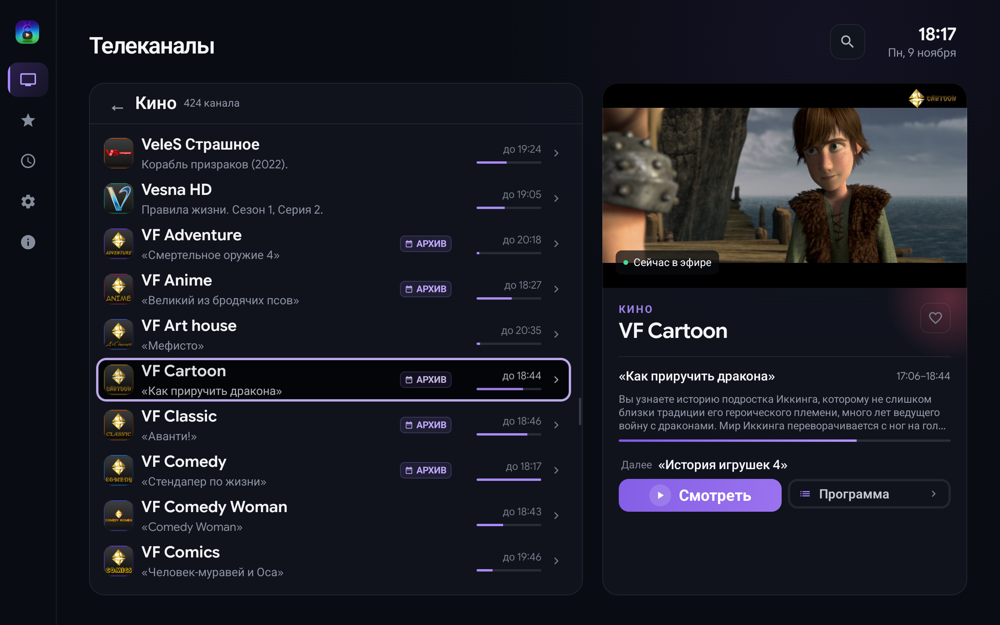
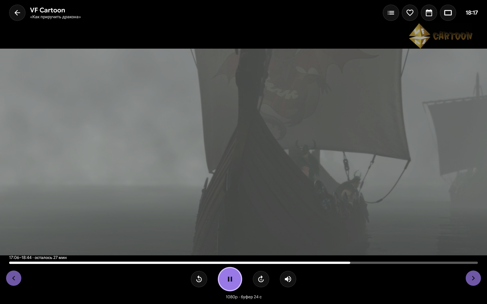
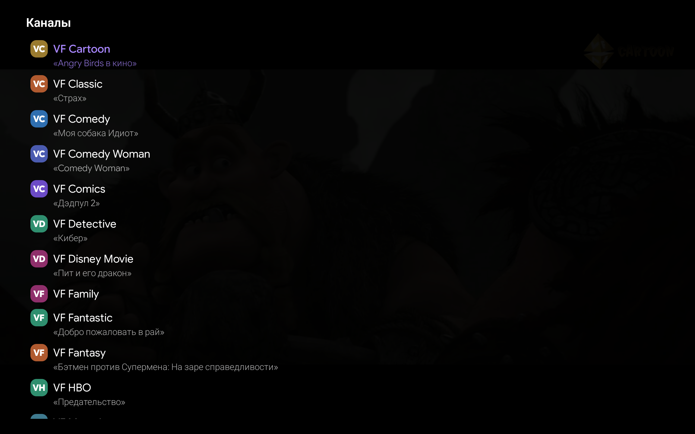
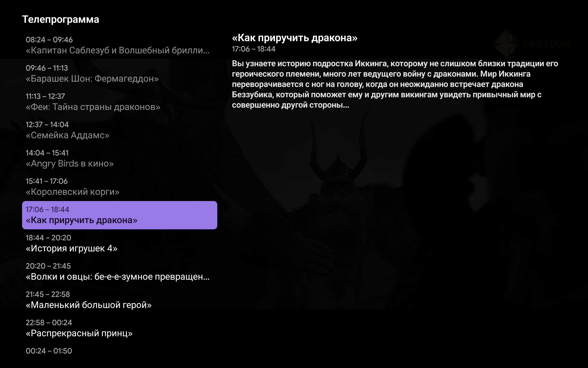
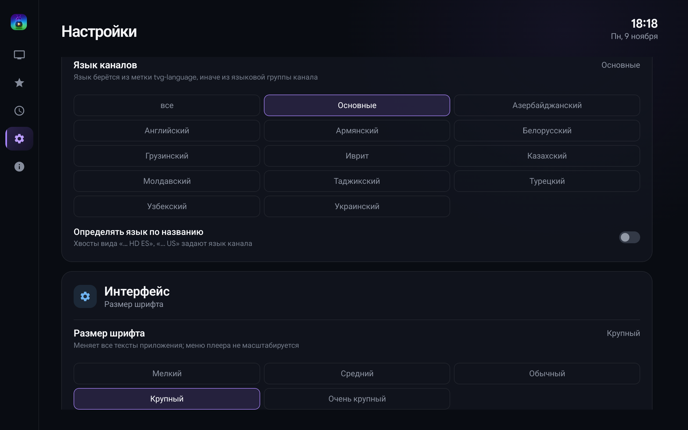

# Смотришка ТВ

**SmotrishkaTV** — домашний IPTV-клиент для Android TV и планшета: каналы, программа передач и
архив в одном приложении. Один APK на оба устройства: на телевизоре — пультом, на планшете —
пальцем.

> Личное приложение для семьи. В магазинах не публикуется, ставится вручную по APK.

## Что это даёт

Включили приставку — и сразу видно, что идёт по любимым каналам, что будет дальше и что можно
пересмотреть. Одна раскладка на телевизор и планшет: разделы слева, каналы и карточка
выбранного — справа, программа и архив — в один шаг. Никаких аккаунтов, подписок и лишних
экранов.

## Разделы

**Телеканалы.** Слева — категории: выбрали категорию, и на её месте открывается список её
каналов (логотип, название, что идёт сейчас, полоса прогресса). «Назад» возвращает к
категориям. Справа — карточка выбранного канала с логотипом, категорией, передачами «сейчас» и
«далее»; отсюда канал запускается, а его сетка передач разворачивается на весь экран.

**Избранное.** Каналы, отмеченные сердцем в карточке, собираются в отдельный раздел — без
категорий и лишних плашек.

**Недавние.** Всё, что уже смотрели, свежими вперёд: не нужно искать канал заново.

**Поиск.** Оверлей по названию канала: список фильтруется сразу, пока набираете.

**Настройки.** Шесть карточек: источник каналов, язык каналов, интерфейс, воспроизведение,
домашний экран, программа передач и плеер. Источник можно сменить, вернуть прежний или загрузить
заново.

## Язык каналов и шрифт

Язык берётся из метки `tvg-language` плейлиста, иначе — из категории канала («Точик»,
«O'zbek», «Moldovenească» и другие написания распознаются), а по желанию — ещё и из хвоста
названия вида «… HD ES». Найденный язык сохраняется у канала, поэтому фильтр работает сразу,
без повторного разбора плейлиста.

В настройках выбирается один язык — в списке остаются его каналы и каналы без метки, чтобы
помеченные вручную никогда не пропадали. «Основные» показывает только каналы без языка: удобно,
когда язык нужен лишь части каталога. Пустые категории после фильтра скрываются.

Размер шрифта — пять вариантов от «Мелкого» до «Очень крупного». Масштабируется весь интерфейс:
списки, карточка, оверлеи; меню управления плеером не масштабируется, чтобы не наезжать на кадр.

## Программа и архив

Экран программы канала — лента передач по времени: видно, что идёт и что будет. Прошедшие
передачи можно смотреть заново, если канал отдаёт архив; в шапке плеера появляются «АРХИВ» и
«В эфир», а в строке — «воспроизведение m:ss».

Глубина архива настраивается — до семи суток. Гиды XMLTV добавляются вручную и участвуют в
фоновом обновлении: недостающие передачи подтягиваются из них, лишний гид удаляется одним
нажатием. Сдвиг времени программы задаётся по каналу. Провайдерский гид из плейлиста
подхватывается сам.

Если канал получает сетку из нескольких гидов, одна и та же передача раньше показывалась
несколько раз. Теперь повторы схлопываются по названию и перекрытию времени — сразу в запросе к
базе, — а канал без сохранённой связи с гидом сопоставляется по названию, поэтому передача
видна и в списке каналов, и в телепрограмме одинаково.

## Плеер

Полноэкранный плеер с HLS. OSD в верхней полосе: название канала, «сейчас» и «далее», бейдж
архива, кнопки. Поверх видео открываются панели «Недавние каналы» и «Телепрограмма», не
отрываясь от эфира.

Каналы переключаются не выходя к списку: кнопками канала на пульте, стрелками вверх/вниз или
свайпом на планшете. Кнопки канала работают даже при открытом оверлее — списком, недавними или
телепрограммой на экране; стрелки, наоборот, принадлежат оверлею. «Назад» сначала закрывает
открытый оверлей и выходит из плеера только когда закрыто всё; удержание «назад» открывает
недавние.

Ушло приложение в фон — звук и сеть замолкают, при возврате эфир продолжается с текущего
момента, а не с того, на котором свернули.

Звук — на любых каналах: AC-3 и E-AC-3 декодирует встроенный FFmpeg-декодер, дорожку можно
выбрать, русская — по умолчанию. Остальное подстраивается под сеть и привычки: буфер вперёд,
качество, повторы при обрыве, экономия трафика, режим кадра, прямой поток или свой буфер.
Пропал поток — вместо тишины появляется плашка «Проблемы с подключением», плеер сам
перезапускает воспроизведение.

## Телевизор и планшет

Тот же APK ставится на приставку и на планшет: баннер в лаунчере, управление пультом или пальцем
и видимая рамка фокуса. На домашнем экране Android TV живёт лента «Сейчас идёт» — канал
открывается прямо из карточки. В настройках ленту можно выключить или ограничить числом каналов.

Список каналов показывает, что идёт сейчас и сколько осталось; карточка справа — текущую и
следующую передачу. Одинаково на обоих устройствах: одни и те же разделы, оверлеи и настройки.

## Источники

Подключается любой из четырёх способов: ссылка на плейлист M3U, код iedem.tv, логин Xtream или
файл плейлиста из памяти устройства.

Реальные плейлисты понимаются как есть: разные кодировки (UTF-8, UTF-16, cp1251), gzip,
заголовки потоков, провайдерские варианты архива. Каталог обновляется при запуске приложения,
программа передач — заранее, за час до того, как закончится сохранённая; если программа уже
устарела, новая скачивается сразу при запуске. Всё — только при наличии сети, чтобы не тянуть
трафик впустую.

Коды и пароли не лежат на диске в открытом виде: они шифруются ключом из Android Keystore.

## Медиатека

Фильмы и сериалы портала провайдера — отдельный раздел. Он появляется в меню только после того,
как в «Настройках» вставлена и проверена порталом ссылка из личного кабинета. Внутри:
категории портала, сетка постеров с догрузкой, панель превью, поиск по медиатеке, карточка
с сериями, плеер с продолжением с места и отсчётом перед следующей серией, избранное — у него
в разделе «Избранное» своя категория рядом с телеканалами. Портал, ключ и избранное входят
в файл настроек. Формат портала описан в [docs/edem-vod.md](docs/edem-vod.md).

## Что дальше

- [ ] **Обновление прямо в приложении**
- [ ] **Видеофильтры в плеере**
- [ ] **Автоматическое выравнивание звука**

## Скриншоты

Сняты на планшете 2560×1600 (Lenovo TB321FU), сборка 0.1.0-rc.4.

| Экран | Снимок |
|---|---|
| Главный экран: категория «Кино», передача и карточка канала |  |
| Плеер с меню управления |  |
| Список каналов поверх плеера |  |
| Телепрограмма поверх плеера |  |
| Настройки: язык каналов и размер шрифта |  |

## Собрать и установить

Нужны JDK 21 и Android SDK 37; приложение работает на Android 8.0 и новее.

```bash
export JAVA_HOME=<путь к JDK 21>
export ANDROID_HOME=<путь к Android SDK>

./gradlew :app:assembleDebug
# APK появится после сборки: app/build/outputs/apk/debug/app-debug.apk
```

Установка на подключённое устройство по USB:

```bash
adb install -r <путь к app-debug.apk>
adb shell am start -n com.mops1k.smotrishka.tv/.MainActivity
```

## Подробности

- [docs/specification.md](docs/specification.md) — что именно делает приложение по каждому экрану
  и правилу (для разработки и приёмки).
- [docs/design/README.md](docs/design/README.md) — дизайн-документ редизайна: палитра, каркас,
  экраны, компоненты, чек-лист приёмки.
- [docs/iedem-by-code.md](docs/iedem-by-code.md) — как работает подключение по коду iedem.tv:
  запросы, адреса, подстановка ключа, поток, архив, программа передач и ошибки.
- [docs/audio-leveling.md](docs/audio-leveling.md) — исследование по выравниванию звука (DRC).
- [AGENTS.md](AGENTS.md) — правила работы над проектом.
- [План работ и решения по этапам](.dsh/plans/smotrishka-iptv-klient-dlya-android-tv-i-android.md) —
  как проект развивался и почему приняты текущие решения.
