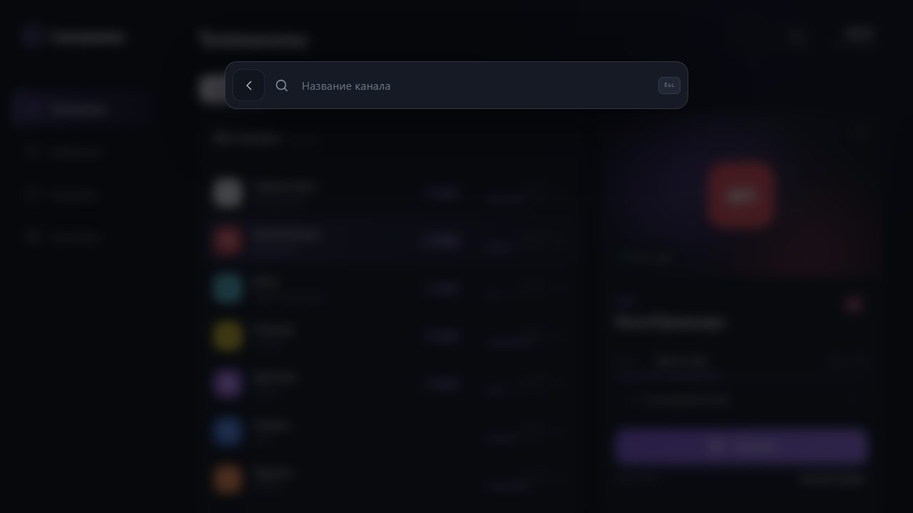
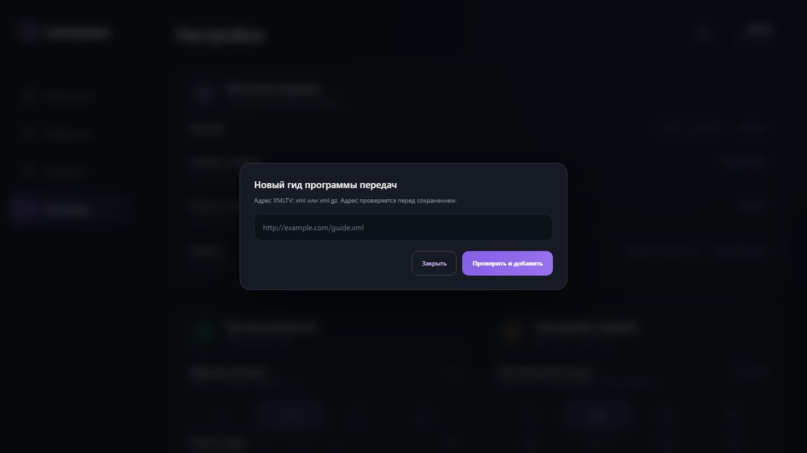

# Оверлеи

Слои, перекрывающие текущий экран. Порядок по `z-index`:

| z-index | Слой |
|---|---|
| 20 | сайдбар |
| 5 | подсветка фокуса (`outline` поверх соседей) |
| 50 | поиск |
| 55 | диалог добавления гида |
| 60 | тост |
| 70 | плеер |
| 3 (внутри плеера) | панели «Недавние» / «Телепрограмма» |

## Поиск

Открывается кнопкой-лупой в шапке контента. Доступен во всех разделах, кроме плеера.

| Часть | Спецификация |
|---|---|
| Оверлей | `position: fixed; inset: 0`, `z-index: 50`, фон `rgba(5,7,10,.73)`, `backdrop-filter: blur(8px)`, контент прижат к верху: `padding-top: 12vh`, по центру |
| Диалог | ширина `min(650px, calc(100% - 30px))`, `padding 10`, зазор 13, фон `#151a24`, рамка `rgba(255,255,255,.12)`, радиус 17, тень `0 25px 80px rgba(0,0,0,.5)` |
| Состав | круглая кнопка «Назад» 45, иконка поиска, поле ввода, `kbd` |
| Поле | прозрачный фон, текст 16 белый, плейсхолдер `Название канала` цвет `#6e7583` |
| `kbd` | подпись `Esc`: 9, `#727987`, фон `#222833`, рамка `#343b48`, радиус 6, `padding 4px 7px` |

Поведение:

- при открытии фокус сразу в поле ввода;- ввод фильтрует список каналов по подстроке в названии (регистр не важен), счётчик в шапке
  панели показывает результат;
- закрывается по Esc, системной «назад» и клику мимо диалога;
- если ничего не найдено, показывается пустое состояние списка («Каналы не найдены»).

## Диалог добавления гида XMLTV

Открывается действием «Добавить» в настройках, карточка «Программа передач».

| Часть | Спецификация |
|---|---|
| Оверлей | `position: fixed; inset: 0`, `z-index: 55`, фон `rgba(5,7,10,.73)`, `blur(8px)`, карточка по центру, `padding 20` |
| Карточка | ширина `min(520px, 100%)`, `padding 22`, фон `#151a24`, рамка `rgba(255,255,255,.12)`, радиус 17, тень `0 25px 80px rgba(0,0,0,.5)` |
| Заголовок | «Новый гид программы передач» 15/600 |
| Пояснение | «Адрес XMLTV: xml или xml.gz. Адрес проверяется перед сохранением.» — 10 `#8b92a0`, отступ сверху 6 |
| Поле | на всю ширину, `min-height 43`, `margin-top 14`, фон `#0d1118`, рамка `var(--line)`, радиус 11, текст 12 белый, плейсхолдер `http://example.com/guide.xml` цвет `#6e7583` |
| Кнопки | справа, зазор 9, отступ сверху 16: «Закрыть» — второстепенная (39, рамка `#484052`, текст `#c8b7f1`, радиус 10, 10/600); «Проверить и добавить» — главная (39, фон `linear-gradient(120deg,#845ee5,#9b73ef)`, текст белый 10/700, радиус 10) |

Поведение:

- пустой адрес — отказ: «Введите адрес гида»;
- иначе гид появляется в списке, тост «Гид добавлен», диалог закрывается;
- имя гида в списке — домен из адреса (`epg.example.net`), адрес показывается целиком;
- в приложении перед сохранением адрес проверяется сетью, недоступный не добавляется —
  текст пояснения это и обещает.

## Тост

Единый индикатор подтверждения действий.

| Часть | Спецификация |
|---|---|
| Расположение | `position: fixed`, по центру снизу (`bottom: 29px`), `z-index: 60` |
| Контейнер | `padding 10px 17px 10px 10px`, зазор 10, фон `#222731`, рамка `rgba(255,255,255,.1)`, радиус 13, тень `0 15px 50px rgba(0,0,0,.4)`, текст 11 белый |
| Иконка | круг 27, фон `rgba(69,223,154,.12)`, цвет `#64e3aa`, галочка 17 |

Длительность 2.4 с, одновременно показывается один тост.

Где используется в макете: «Открылась смена источника», «Открылся выбор файла», «Каталог
возвращён к провайдеру», «Плейлист обновляется», «Гид добавлен», «Гид удалён»,
««Название» начнётся в 22:00».

## Подсказка режима кадра

`.player-hint` — см. [`player.md`](player.md). Центр экрана, 1.6 с.

## Затемнения (без самостоятельного оверлея)

| Слой | Значение |
|---|---|
| Поиск | `rgba(5,7,10,.73)` + `blur(8px)` |
| Диалог гида | `rgba(5,7,10,.73)` + `blur(8px)` |
| Панель плеера | `rgba(4,6,10,.38)` + `blur(2px)` |
| Скримы OSD плеера | сверху `rgba(4,6,10,.88)` → прозрачный к 24 %, снизу `rgba(4,6,10,.92)` → прозрачный к 36 % |
