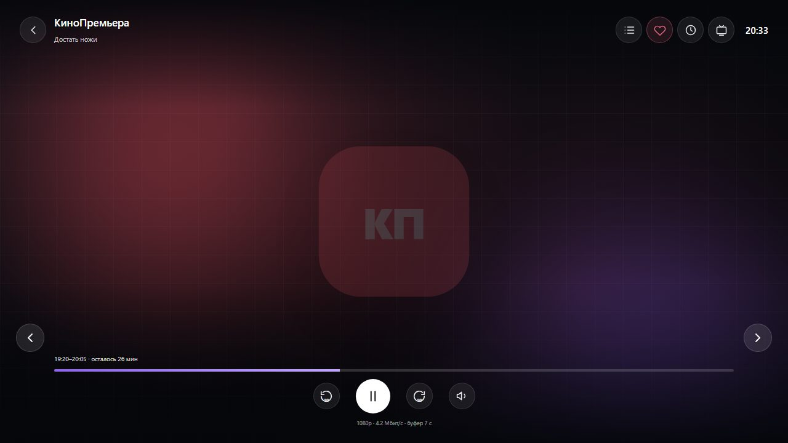
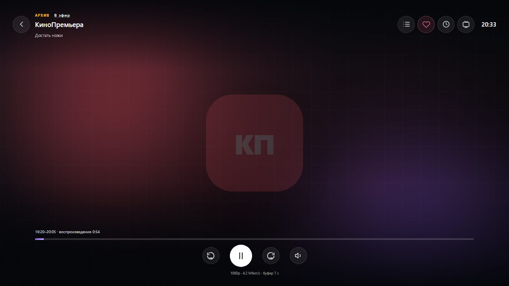
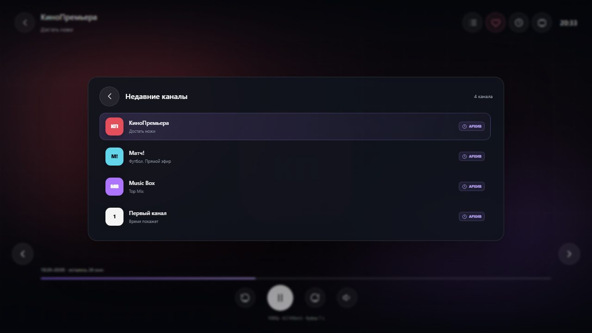
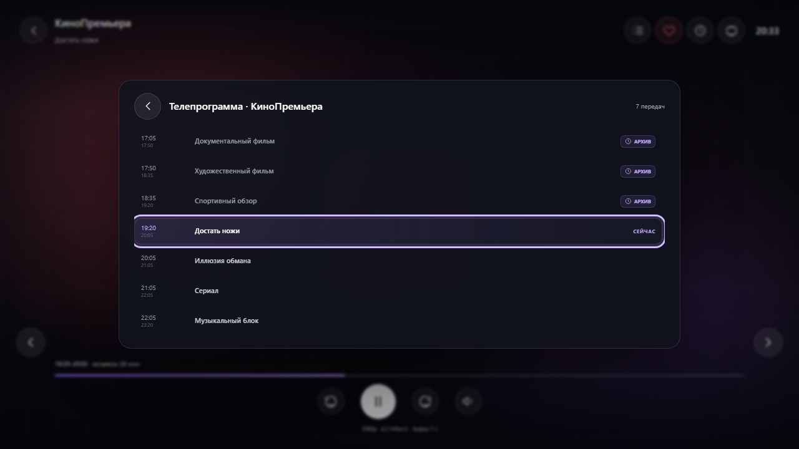

# Плеер

Отдельный полноэкранный слой поверх приложения. В макете **ничего не воспроизводит**: на месте
видео — статичная «эфирная» картинка, управление рисуется поверх.

## Слои (снизу вверх)

| Слой | Спецификация |
|---|---|
| Контейнер `.player` | `position: fixed; inset: 0; z-index: 70`, фон `#000` |
| Полотно `.player-surface` | абсолютное на весь экран, центрирование содержимого, `overflow: hidden` |
| Полотно: градиенты | `radial-gradient(circle at 30% 26%, <цвет канала>2e, transparent 46%)`, `radial-gradient(circle at 74% 68%, <цвет канала>1f, transparent 52%)`, под ними `linear-gradient(160deg,#0d1017,#05070b 62%)` |
| Полотно: сетка | псевдоэлемент `::after`: линии `rgba(255,255,255,.022)` с шагом 46 px |
| Полотно: пятна | `.player-ambient` 420×420, радиус 42 %, `blur(130px)`, прозрачность .42: левое — цвет канала (4 % слева, 6 % сверху), правое — `#7c55e8` (2 % справа, ниже края) |
| Полотно: вотермарк | логотип канала крупным планом (94→244), `opacity .16`, `transform: scale(2.6)` |
| OSD | абсолютный слой, `z-index` по порядку — выше полотна |
| Панели плеера | `.player-overlay`, `z-index: 3` |
| Подсказка режима кадра | `.player-hint`, по центру |

Смысл картинки: экран «как будто эфир идёт». В приложении на этом месте реальное видео, все
перечисленные градиенты не нужны.

## Загрузка

Пока плеер готовится (макет — 1.5 с после входа), вместо OSD по центру текст 13 цвета `#cfd4dd`:

- прямой поток: `Загрузка…`;
- собственный буфер: `Готовим буфер… 5 с`;
- архив: `Готовим архив… 12 %` (процент заполнения).

В приложении это состояния `player == null` / первый кадр не получен.

## OSD: верхняя полоса

`padding 24px 32px 26px` на весь экран, колонка `space-between`, скримы:
`linear-gradient(180deg, rgba(4,6,10,.88), transparent 24%)` и
`linear-gradient(0deg, rgba(4,6,10,.92), transparent 36%)`.

| Элемент | Спецификация |
|---|---|
| «Назад» | круглая кнопка 43 (фон `rgba(255,255,255,.07)`, рамка `rgba(255,255,255,.12)`, иконка 22) |
| Заголовок | название канала 17/600 белое; под ним название текущей передачи 11 `rgba(255,255,255,.72)` |
| «АРХИВ» (только в архиве) | строка над названием: текст `АРХИВ` 9/700 `#ffc107`, `letter-spacing 1.2px`, рядом кнопка «В эфир» — белая 10/600 с подчёркиванием `rgba(255,255,255,.35)` |
| «Программа канала» | иконка списка 20 — открывает панель «Телепрограмма» |
| «Избранное» | сердце 20; активное — `#e76983`, фон `rgba(231,105,131,.12)`, рамка `rgba(231,105,131,.4)` |
| «Недавние каналы» | иконка часов 20 — открывает панель «Недавние» |
| «Режим кадра» | иконка 20; подпись режима — в подсказке по центру |
| Часы | `20:33` 15/600 белые, отступ слева 11, `tabular-nums` |

Кнопки в ряду: зазор 7, каждый круг 43.

## OSD: нижняя полоса

Блок с `padding-inline: 56px` (чтобы не наезжать на боковые стрелки), колонка с зазором 9.

1. **Строка передачи**: `19:20–20:05 · осталось 26 мин` — 10, `rgba(255,255,255,.85)`,
   `tabular-nums`. Формат остатка: `осталось N мин`, при N < 1 — `передача закончилась`.
   В архиве вместо остатка: `воспроизведение m:ss`.
2. **Полоса перемотки**: высота 4, радиус 4, дорожка `rgba(255,255,255,.16)`, заливка
   `linear-gradient(90deg,#8b63ec,#c1a4ff)`.
3. **Ряд управления**: по центру, зазор 26, отступ сверху 3.
   - «назад 10 с»: круг 43 с иконкой и цифрой `10` (7/700) внизу иконки;
   - главная кнопка: 56, круг, белый фон, иконка 26 тёмная (`#0a0c11`) — пауза либо play;
   - «вперёд 10 с»: как назад;
   - звук: круг 43, иконка динамика либо перечёркнутого динамика.
4. **Статистика**: по центру, 9, `rgba(255,255,255,.55)`, например
   `1080p · 4.2 Мбит/с · буфер 7 с`. В приложении добавляются суффиксы `· буфер (авто)` и
   `· нестабильный поток`.

## Боковые стрелки каналов

Только в эфире (в архиве не показываются): круг 46 у левого и правого края,
`bottom: 148px`, фон `rgba(255,255,255,.1)`, рамка `rgba(255,255,255,.16)`, иконка 24;
hover — фон `rgba(255,255,255,.2)`. Переключают канал на предыдущий/следующий по порядку
списка, экран не закрывается.

## Поведение OSD

- Появляется при входе в плеер.
- Гаснет сам через 5 секунд (в приложении — таймер `controls.onInteraction()`).
- Клик по пустому месту скрытого OSD возвращает его; клик по пустому месту открытого —
  скрывает.
- Пока открыта панель, таймер не работает.

## Архивный режим

Включается при входе из прошедшей передачи телепрограммы.

- В шапке появляются `АРХИВ` и «В эфир».
- Строка передачи показывает `воспроизведение m:ss` вместо остатка.
- Боковые стрелки скрыты.
- «В эфир» выключает архивный режим, возвращая прямой поток.
- Запись начинается с начала передачи, поэтому позиция при входе — около `0:54`.

Архив есть не у всех каналов: у «Music Box» глубина 3 суток, у «Планета» архива нет вовсе.
Снимки: [`archive-programme-musicbox.jpg`](screens/components/archive-programme-musicbox.jpg) —
панель с бейджами, [`archive-programme-no-archive.jpg`](screens/components/archive-programme-no-archive.jpg) —
панель без архива. Поведение для прошедшей передачи без архива описано в
[`flows.md`](flows.md) (в макете это место содержит дефект).

## Панели «Недавние каналы» и «Каналы»

Обе панели открываются поверх эфира и устроены одинаково: список каналов на всю ширину панели,
а описание текущей передачи выбранного канала — под его строкой. «Недавние каналы» открываются
кнопкой часов в OSD, «Каналы» — кнопкой «влево» при скрытом OSD.
**Не отдельный экран**: карточка поверх видео, эфирная картинка и полосы OSD остаются видны.

| Часть | Спецификация |
|---|---|
| Оверлей | абсолютный на весь экран, `padding 96px 40px 130px`, фон `rgba(4,6,10,.38)`, `backdrop-filter: blur(2px)`, центрирование карточки |
| Карточка | ширина `min(900px, 100%)`, `max-height 100%`, `padding 20px 24px 22px`, радиус 20, фон `rgba(17,21,30,.84)`, рамка `rgba(255,255,255,.12)`, `blur(18px)`, тень `0 30px 90px rgba(0,0,0,.55)` |
| Шапка | кнопка «Назад» 43 + заголовок «Недавние каналы»/«Каналы» 16/600 + счётчик справа 10 `#9aa1af` («4 канала» со склонением), зазор 13 |
| Список | колонка на всю ширину карточки, зазор 6, прокрутка, `padding-right 4` |
| Строка канала | сетка `38px | minmax(0,1fr) | 92px | 105px`, `padding 9px 12px`, радиус 13, зазор 12; логотип 32, название 12/600 `#f4f4f6`, передача 9 `#8a91a0`; в колонке 92 — метка «Архив» (пустая, если архива нет), в колонке 105 — время `до 21:30` 9 `#8a91a0` и под ним полоса прогресса текущей передачи (дорожка `#272c37`, заливка `#ab8af9`, высота 3, радиус 5) |
| Прогресс без передачи | если передача неизвестна, время и полоса не рисуются, но колонка 105 остаётся: строки не смещаются |
| Описание | только у строки под фокусом, под ней: отступ слева 48, 9 `rgba(26,16,48,.8)`, до 3 строк; у канала без описания строка не растягивается |
| Активная строка | фон `linear-gradient(100deg,rgba(160,127,241,.18),rgba(160,127,241,.04))`, рамка `rgba(176,145,251,.24)` |

Колонки фиксированы намеренно: при делении экрана на две части (список + описание справа) правые
элементы строки уезжали влево и при листании «скакали» (замечание Александра 09.11.2026).

Метка «Архив» показывается по заявке плейлиста (решение Александра 09.11.2026): фоновая
проверка выдачи давала ложные «нет архива» у каналов, где он есть. Прогресс считается по границам
текущей передачи с поправкой на сдвиг гида канала — по тем же, что подпись `до 21:30`.

Поведение: фокус при открытии — на играющем канале, его описание и видно под строкой; при переходе
фокуса описание переезжает под выбранный канал; клик по каналу переключает плеер и закрывает
панель; «Назад», Esc или клик мимо карточки закрывают панель; раздел приложения под плеером
не меняется никогда.

Поведение «назад»: короткое нажатие закрывает открытую панель, а если открывать нечего — выходит
из плеера. Predictive back отключён (`android:enableOnBackInvokedCallback="false"`): Android 13+
отдавал `KEYCODE_BACK` и нашему обработчику, и системному `BackHandler`, из-за чего одно нажатие
закрывало и панель, и плеер.

Удержание «назад» (≈300 мс) открывает панель «Недавние каналы» там, где это позволяет прошивка.
На части телефонов (проверено на Realme/ColorOS 09.11.2026) удержание «назад» — системная функция:
она принудительно останавливает любое приложение через ~500 мс (`Force stopping … from pid … (system)`
в logcat). Порог намеренно ниже этой границы, чтобы панель успела показаться до закрытия — так же
ведут себя другие IPTV-клиенты. Для приставки, где прошивка не вмешивается, этот же порог работает
как обычное удержание.

## Панель «Телепрограмма»

Открывается кнопкой «Программа канала» в OSD. Та же карточка и оверлей, отличается
содержимым:

| Часть | Спецификация |
|---|---|
| Заголовок | `Телепрограмма · <название канала>` 16/600 |
| Счётчик | «7 передач» 10 `#9aa1af` |
| Список | 7 строк того же вида, что в развороте телепрограммы (`76px | 1fr | auto`, `min-height 42`) |
| Прошедшие | название `#9aa1ae`, справа бейдж «Архив» |
| Текущая | подсвечена, время `#bda6f5`, справа «Сейчас» |
| Будущие | без бейджа |

**Фокус при открытии — на текущей передаче**, список прокручен так, чтобы она была по центру.
В приложении: `focusRequester` на строке с `state == NOW` + `LazyListState.scrollToItem`.

Поведение по клику: текущая — панель закрывается; прошедшая с архивом — плеер переходит в
архивный режим и панель закрывается; будущая — подсказка ««Название» начнётся в 22:00».

## Подсказка режима кадра

По центру экрана, `padding 9px 16px`, радиус 11, фон `rgba(10,12,18,.86)`, рамка
`rgba(255,255,255,.14)`, текст 11/600 белый. Показывается 1.6 с после переключения режима и
содержит название режима: `Вписать`, `Растянуть`, `Обрезать`, `1:1`. Режимы переключаются по
кругу в этом же порядке.

## Выход из плеера

«Назад» в OSD, Esc или системная кнопка «назад»: если открыта панель — закрывается панель,
иначе закрывается плеер и возвращается список каналов.
