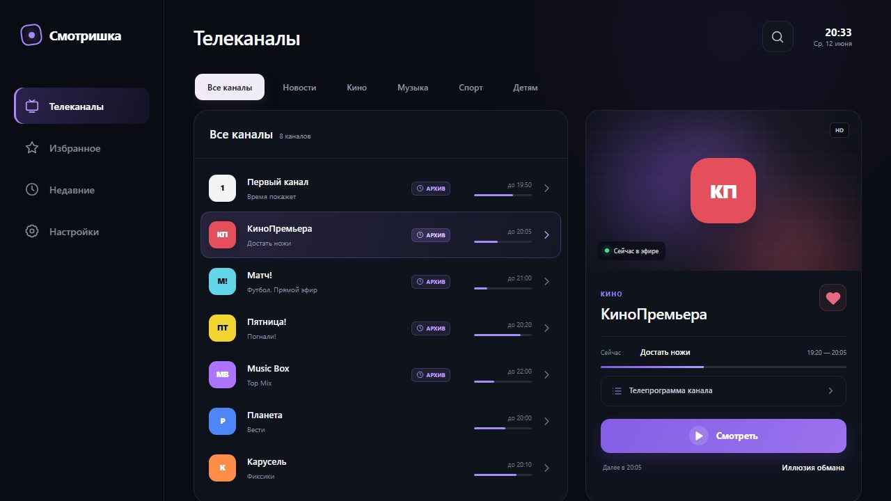
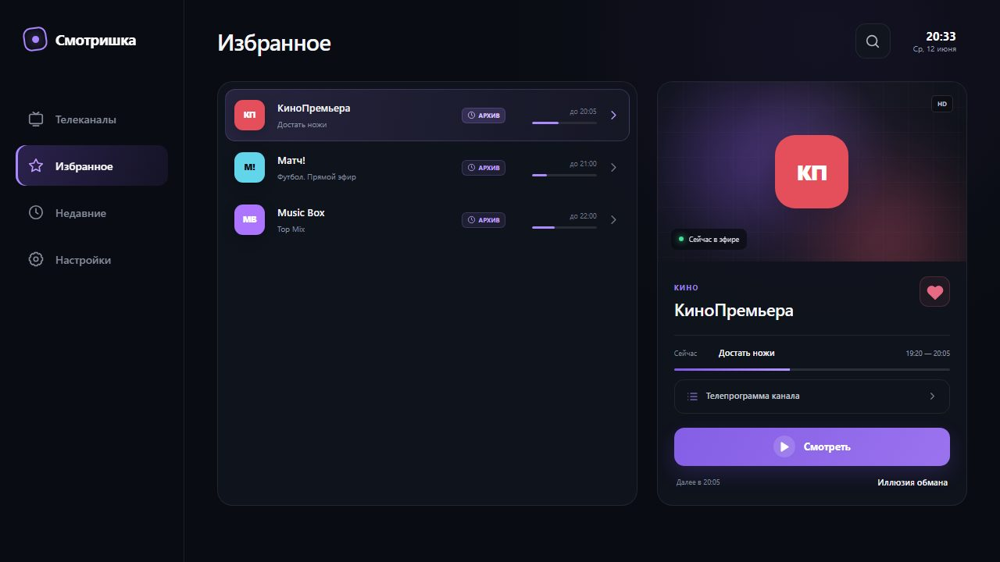
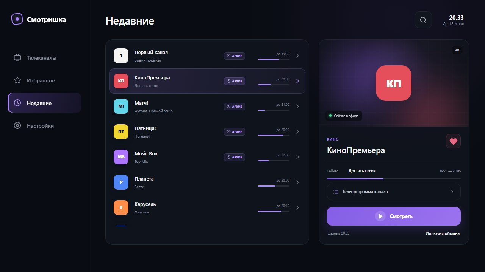
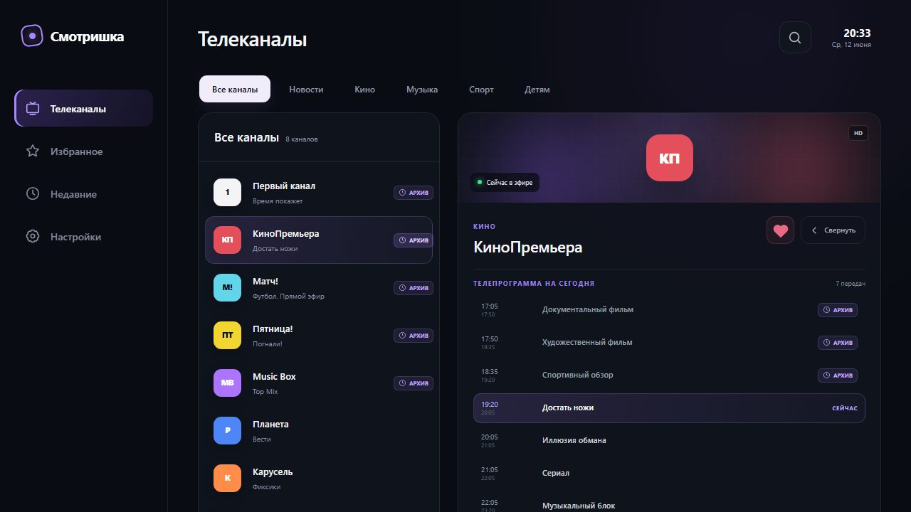
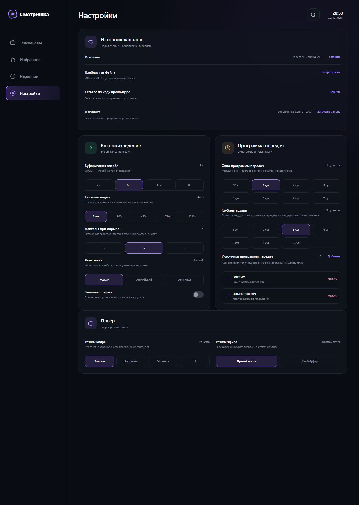
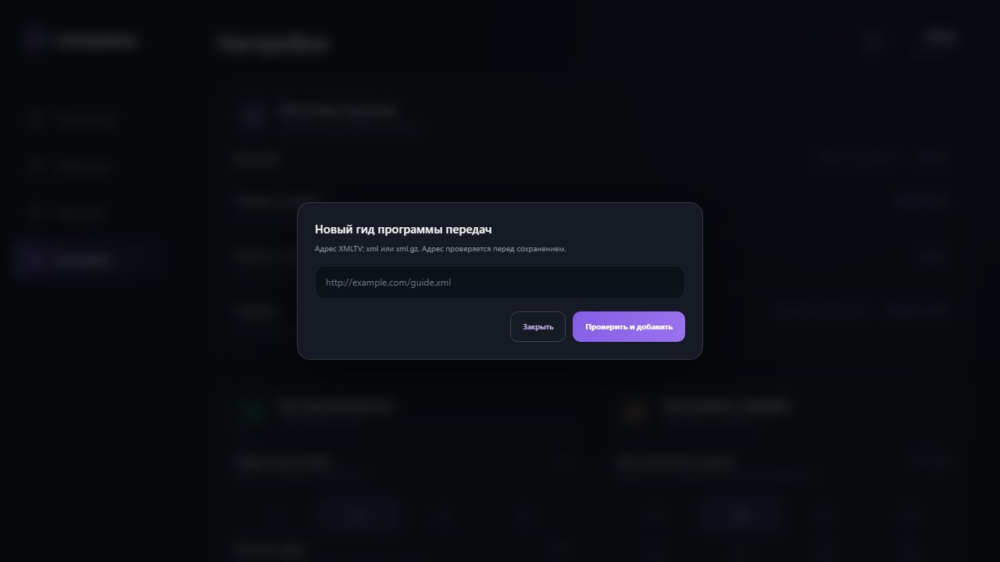
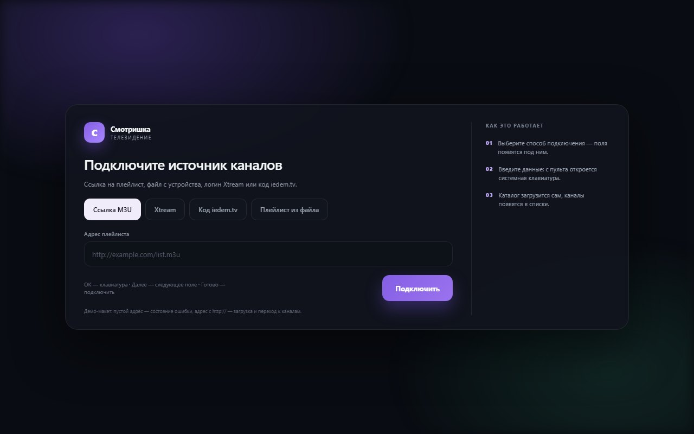

# Экраны

Размеры — из `src/index.css` макета, тексты — дословно из макета.



Каждый из экранов снят дважды: 1280 px для чтения и 1920×1080 в
[`screens/fullhd/`](screens/fullhd/) — по ним удобно сверять масштаб при переносе на ТВ.

## Общее для трёх разделов со списком

«Телеканалы», «Избранное», «Недавние» используют одну сетку `.content-grid`:

- `grid-template-columns: minmax(480px,1.15fr) minmax(350px,.85fr)`, зазор 25;
- левая колонка — панель списка каналов, правая — карточка выбранного канала;
- при развороте телепрограммы колонки меняются (см. ниже).

Различия по разделам:

| Раздел | Плашка категорий | Шапка панели списка | Что в списке |
|---|---|---|---|
| Телеканалы | есть | есть: имя категории + счётчик | каналы выбранной категории |
| Избранное | нет | нет | только избранные каналы |
| Недавние | нет | нет | все каналы (пробел, см. README) |





## Плашка категорий

Только в «Телеканалах». Горизонтальный ряд с прокруткой: `padding 2px 2px 14px`, зазор 8.

Категории в порядке макета: `Все каналы`, `Новости`, `Кино`, `Музыка`, `Спорт`, `Детям`.

| Состояние | Спецификация |
|---|---|
| Покой | прозрачный фон, текст `#9399a7`, 12/600, `padding 10px 18px`, радиус 11 |
| Hover | фон `rgba(255,255,255,.05)`, текст белый |
| Активная | фон `#f0ecfa`, текст `#17131e`, тень `0 7px 25px rgba(169,135,255,.11)` |

## Панель списка каналов

| Часть | Спецификация |
|---|---|
| Панель | фон `rgba(17,21,30,.82)`, рамка 1 px `var(--line)`, радиус 20, `overflow: hidden` |
| Шапка | высота 69, `padding 0 22`, рамка снизу; h2 17/600 + счётчик 10 цвета `var(--muted)`, зазор 9 по базовой линии |
| Счётчик | «N каналов» со склонением: 1 канал / 2 канала / 8 каналов |
| Список | `padding 9px`, `max-height: calc(100vh - 226px)`, вертикальный скролл |
| Пустое состояние | `min-height 290`, по центру: иконка поиска 34, заголовок «Каналы не найдены» 14, подпись «Попробуйте выбрать другую категорию» 10, цвет `#666e7d` |

Сортировки в шапке нет: кнопка «По популярности» удалена по решению Александра — в приложении
нет популярности, есть просто список каналов.

### Строка канала

Кнопка на всю ширину, `min-height 67`, `padding 7px 11px`, зазор 12, колонки:

```
43px | minmax(150px,1fr) | 92px | 105px | 18px
логотип | название и передача | бейджи | время и прогресс | шеврон
```

Пятая колонка (бейджи) существует **всегда**, даже пустая: иначе строки с бейджем сдвигали
бы время и прогресс, и появлялись бы «скачки». Колонка выровнена по правому краю.

| Элемент | Спецификация |
|---|---|
| Логотип | 39×39, радиус 11, тень `0 5px 17px rgba(0,0,0,.2)`, текст 11/800, `letter-spacing -.5px`; фон — цвет канала, текст — `#091017` на светлом логотипе и `#fff` на тёмном |
| Название | 13/600, `#f4f4f6`, обрезка многоточием |
| Передача | 10, `#8a91a0`, обрезка многоточием, зазор 4 |
| Бейдж «Архив» | см. ниже |
| Время | «до 20:05», 9, `#717887`, выравнивание вправо |
| Прогресс | дорожка 83×3, радиус 5, фон `#272c37`, заливка `#ab8af9`; ширина заливки — процент передачи, зазор до времени 7 |
| Шеврон | 19 px, цвет строки |

Состояния:

- покой: прозрачный фон, текст `#717886`;
- hover: фон `rgba(255,255,255,.035)`;
- выбранная: фон `linear-gradient(100deg, rgba(160,127,241,.16), rgba(160,127,241,.04))`,
  рамка `rgba(176,145,251,.21)`, шеврон `#b99eff`, бейдж архива `#dcc9ff` на
  `rgba(169,135,255,.18)`.

Клик по строке выбирает канал и обновляет правую карточку. В макете шеврон декоративный.

### Бейдж «Архив»

Пилюля справа от названия, в колонке бейджей:

- иконка часов 11 px + текст `Архив` 8/700 uppercase, `letter-spacing` стандартный;
- цвет `#c1a7ff`, фон `rgba(169,135,255,.1)`, рамка 1 px `rgba(169,135,255,.22)`, радиус 6,
  `padding 3px 6px`, зазор с иконкой 4;
- тултип: «Архив 7 дн.» (глубина архива канала в днях);
- у канала без архива колонка остаётся пустой, пилюля не выводится.

## Карточка выбранного канала

Панель `min-height 533`, вертикальная колонка.

### Визуал (верх)

| Элемент | Спецификация |
|---|---|
| Блок | `min-height 230`, по центру, фон `radial-gradient(circle at 50% 40%, #3c3055, #191825 45%, #10131b 80%)`, поверх сетка 32 px с линиями `rgba(255,255,255,.015)` |
| Свечения | два пятна 160×160, радиус 40 %, `blur(50px)`, прозрачность .35: левое `#8857ec` (8 % слева, 10 % сверху), правое `#e2546c` (5 % справа, ниже края) |
| Логотип | 94×94, радиус 26, текст 27/800, тень `0 16px 40px rgba(0,0,0,.32)` |
| `HD` | справа сверху 17 px: 8/700, текст `#b9bec8`, фон `rgba(8,9,13,.47)`, рамка `rgba(255,255,255,.12)`, радиус 5, `padding 4px 7px` |
| «Сейчас в эфире» | слева снизу 17/15 px: точка 6 px `var(--green)` с glow + текст 9, фон `rgba(9,11,16,.72)`, `blur(8px)`, радиус 8, `padding 7px 10px`, зазор 7 |

### Копия (низ): `padding 19px 21px 21px`

1. **Шапка карточки**: категория 9/700 uppercase `#9d80e8`, `letter-spacing 1.3px`; название
   канала h2 22/600 `letter-spacing -.4px`, отступ сверху 2. Справа кнопка избранного.
2. **Избранное**: 39×39, радиус 11, рамка `var(--line)`, иконка сердца `#777e8d`. Активное:
   `#e76983`, фон `rgba(231,105,131,.08)`, рамка `rgba(231,105,131,.2)`, сердце залито.
3. **Блок «Сейчас»** (отступ сверху 16, линия сверху, `padding-top 14`):
   три колонки `48px | 1fr | auto`: подпись «Сейчас» 9 `#7f8695`, название передачи 11/500,
   интервал `19:20–20:05` 9 `#8d94a2` (тире — en dash). Ниже полоса прогресса: высота 3,
   отступ сверху 11, дорожка `#292e39`, заливка `linear-gradient(90deg,#8057e8,#b596ff)`.
4. **«Телепрограмма канала»**: кнопка на всю ширину, `min-height 44`, отступ сверху 11, зазор
   10, `padding 0 14`, радиус 12, рамка `var(--line)`, текст 11/600 `#c3c9d4`, иконка списка
   `var(--accent)` слева, шеврон справа (`#7f8695`). Hover: текст белый, рамка
   `rgba(169,135,255,.34)`, фон `rgba(169,135,255,.07)`, шеврон акцентный. Это единственный
   вход в разворот телепрограммы из карточки.
5. **«Смотреть»**: `min-height 49`, отступ сверху 18, радиус 13, фон
   `linear-gradient(120deg,#845ee5,#9b73ef)`, текст 13/700 белый, тень
   `0 10px 26px rgba(120,78,222,.22)`; слева круг 28 с полупрозрачным фоном
   `rgba(255,255,255,.15)` и белым треугольником. Открывает плеер (см. [`player.md`](player.md)).
6. **«Далее в 20:05»**: строка между краями, отступ сверху 13, `padding 0 3`: подпись 9
   `#7f8695`, название следующей передачи 11/500.

### Разворот телепрограммы (`program-open`)



Состояние раздела «Телеканалы», открывается кнопкой «Телепрограмма канала» из п. 4.

| Часть | Спецификация |
|---|---|
| Сетка | `minmax(340px,.68fr) minmax(540px,1.32fr)` — список сжимается, панель расширяется |
| Визуал карточки | `min-height 126`, логотип 66 (радиус 19, текст 20) |
| Шапка карточки | кнопка «Свернуть» 39 (иконка назад + текст, рамка, радиус 11) рядом с избранным, зазор 9 |
| Заголовок сетки | «Телепрограмма на сегодня» 9/700 uppercase `#9d80e8`, `letter-spacing 1.3px`; справа «N передач» 9 `#7f8695` |
| Контейнер | отступ сверху 15, линия сверху, `padding-top 13`, вертикальный список с прокруткой, зазор 4 |
| Строка передачи | сетка `76px | minmax(0,1fr) | auto`, `min-height 42`, `padding 6px 10px`, радиус 11, зазор 10 |
| Время | две строки: начало 10 `#8d94a2`, конец 8 `#656c7b` (`tabular-nums`) |
| Название | 11/500, обрезка |
| Прошедшая | название `#9aa1ae`; справа бейдж «Архив», если архив есть |
| Текущая | фон `linear-gradient(100deg,rgba(160,127,241,.16),rgba(160,127,241,.04))`, рамка `rgba(176,145,251,.21)`, название белое, время `#bda6f5`, справа «Сейчас» 8/700 uppercase `#bda6f5` |
| Будущая | без бейджа |

Содержимое: 3 прошедшие передачи, текущая, следующая и ещё две вперёд (всего 7).

Клик по прошедшей передаче с архивом открывает плеер в архивном режиме; по текущей — плеер
в эфире; по будущей — подсказка ««Название» начнётся в 22:00» (тост).

## Настройки

Страница карточек, `max-width 1100`. Четыре карточки: источник каналов (на всю ширину),
«Воспроизведение» и «Программа передач» (в две колонки, зазор 17), «Плеер» (на всю ширину).



Карточка: `padding 23`, панель с рамкой и радиусом 20. Шапка карточки: иконка 43×43
(радиус 13) + заголовок 17/600 + подпись 10 `var(--muted)`, зазор 14.

Иконки: фиолетовая (`#bda5fc` на `rgba(149,111,238,.16)`), зелёная (`#61dfa5` на
`rgba(69,223,154,.13)`), оранжевая (`#f0b069` на `rgba(240,176,105,.13)`).

### Строка настройки

Строка «параметр — значение — действие — подсказка»:

- `padding 13px 0`, разделитель сверху `var(--line)` (у первой строки нет);
- верхняя часть: название 12/600, значение 10 `#8b92a0` прижато вправо, действие 10/600
  `var(--accent)` справа с отступом 12; если значения нет, действие уходит вправо;
- подсказка: 9 `#747c8a`, отступ сверху 3.

### Группа вариантов

`grid` с зазором 7, отступ сверху 11. Кнопка: `min-height 40`, `padding 0 8`, радиус 10,
рамка `var(--line)`, текст 10/600 `#8b92a0`. Активная: рамка `#a481f3`, текст белый, фон
`rgba(148,108,238,.16)`. Число колонок задаётся по числу вариантов: 4 для 2/5/10/20 с,
5 для качества, 3 для повторов и языка, 4 для окна и глубины, 2 для режима эфира.

### Карточка «Источник каналов»

| Строка | Значение | Действие | Подсказка |
|---|---|---|---|
| Источник | `iedem.tv · логин 4821…` | Сменить | — |
| Плейлист из файла | — | Выбрать файл | «M3U или M3U8 с устройства или из облака» |
| Каталог по коду провайдера | — | Вернуть | «Вернуть каталог из сохранённого источника» |
| Плейлист | `обновлён сегодня в 19:42` | Загрузить заново | «Скачать каналы и программу передач заново» |

Шапка: «Источник каналов», подпись «Подключение и обновление плейлиста».

### Карточка «Воспроизведение»

| Настройка | Значение по умолчанию | Варианты | Подсказка |
|---|---|---|---|
| Буферизация вперёд | 5 с | 2 с, 5 с, 10 с, 20 с | «Больше — спокойнее при обрывах сети» |
| Качество видео | Авто | Авто, 360p, 480p, 720p, 1080p | «Потолок для каналов с несколькими вариантами качества» |
| Повторы при обрыве | 5 | 3, 5, 8 | «Сколько раз пробовать заново, прежде чем показать ошибку» |
| Язык звука | Русский | Русский, Английский, Оригинал | «Какую дорожку выбирать, если у канала их несколько» |
| Экономия трафика | выключена | переключатель | «Превью не запускается само, логотипы не грузятся» |

Переключатель: 39×22, радиус 20, `padding 3`; выключен — фон `#333946`, кружок 16 `#9299a6`;
включён — фон `#7c59d2`, кружок белый, сдвиг 17 px.

Строка переключателя: `padding 17px 0 3px`, название 11/600, подпись 9 `#777f8d`, зазор 3.

Шапка: «Воспроизведение», подпись «Буфер, качество и звук».

### Карточка «Программа передач»

| Настройка | Значение | Варианты | Подсказка |
|---|---|---|---|
| Окно программы передач | 1 сут назад | 12 ч, 1–7 сут | «Меньше окно — быстрее обновление; глубину задаёт архив» |
| Глубина архива | 3 сут назад | 1–7 сут | «Сколько назад доступны прошедшие передачи; провайдер может отдавать меньше» |
| Источники программы передач | 2 | действие «Добавить» | «Адрес проверяется перед сохранением; недоступный не добавляется» |

Список гидов BELOW строки: карточки `padding 10px 12px`, фон `#0d1118`, рамка `var(--line)`,
радиус 11, зазор 7; иконка списка 15 `#9d80e8`; название 11/600, адрес 9 `#747c8a`
с обрезкой; справа «Удалить» 9/600 `#d78aa0`. Если гидов нет — текст «Гиды не добавлены»
10 `#747c8a`.



Шапка: «Программа передач», подпись «Окно, архив и гиды XMLTV».

### Карточка «Плеер»

Две колонки, зазор 22.

| Настройка | Значение | Варианты | Подсказка |
|---|---|---|---|
| Режим кадра | Вписать | Вписать, Растянуть, Обрезать, 1:1 | «Что делать с картинкой, если пропорции не совпадают» |
| Режим эфира | Прямой поток | Прямой поток, Свой буфер | «Свой буфер сглаживает обрывы, но отстаёт от эфира» |

Шапка: «Плеер», подпись «Кадр и режим эфира». Эти две настройки в приложении живут в плеере,
а не в экране настроек — в макете вынесены отдельной карточкой, чтобы были видны все
возможности приложения.

## Онбординг

Экран до каркаса: подключается источник каналов, пока его нет — смотреть нечего. Полное
описание состояний и полей — в [`onboarding.md`](onboarding.md), снимки —
[`screens/onboarding/`](screens/onboarding/).


