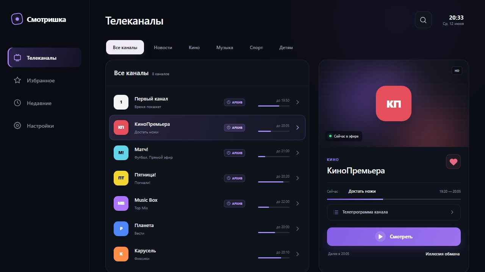

# Каркас приложения

Постоянные части, общие для всех разделов. Размеры — из `src/index.css` макета.



## Структура

```
┌────────────┬──────────────────────────────────────────────────────┐
│  сайдбар   │  шапка: заголовок раздела      поиск · часы           │
│  236 px    ├──────────────────────────────────────────────────────┤
│  (fixed)   │  содержимое раздела (категории + сетка / настройки)   │
└────────────┴──────────────────────────────────────────────────────┘
```

- Корень: `.app-shell` — `min-height: 100vh`, фон приложения со свечением в правом верхнем углу.
- Сайдбар фиксирован слева, контент сдвинут на его ширину.

## Сайдбар

| Часть | Спецификация |
|---|---|
| Контейнер | ширина 236, `fixed` на всю высоту, `padding 31px 20px 25px`, бордер справа `var(--line)`, фон `rgba(10,13,19,.88)`, `backdrop-filter: blur(20px)`, `z-index 20` |
| Бренд | кнопка «Смотришка»: знак 30×30 с рамкой 2 px `var(--accent)`, радиус 10, `rotate(-8deg)`, внутри точка 9 px с glow; название 19/700, `letter-spacing -.5px`; зазор 11, `padding 4px 10px`, радиус 12 |
| Меню | отступ сверху 57, вертикальный список, зазор 8 |
| Пункт меню | `min-height 52`, `padding 0 15`, зазор 14 между иконкой и текстом, радиус 13, цвет `#858c9b`, размер текста 14/600 |
| Пункт в покое | фон прозрачный |
| Пункт hover | текст белый, фон `rgba(255,255,255,.05)` |
| Пункт активный | текст белый, фон `linear-gradient(110deg, rgba(130,89,226,.28), rgba(130,89,226,.09))`, `box-shadow: inset 3px 0 var(--accent)`, иконка `#bc9eff` |

Пункты (порядок и иконки):

| id | Подпись | Иконка |
|---|---|---|
| `tv` | Телеканалы | телевизор |
| `favorites` | Избранное | звезда |
| `recent` | Недавние | часы |
| `settings` | Настройки | шестерёнка |

**Футера нет.** В первой версии макета внизу сайдбара были индикатор «Онлайн» и кнопка
«Профиль» — по решению Александра удалены полностью: в приложении профилей и статуса
подключения нет. Не возвращать.

Клик по бренду возвращает в раздел «Телеканалы».

## Шапка контента

| Часть | Спецификация |
|---|---|
| Контейнер | `display: flex`, выравнивание по нижнему краю, `justify-content: space-between`, отступ снизу 29 (17 в узком режиме) |
| Заголовок | h1: 29/600, `letter-spacing -.8px`. Текст зависит от раздела: «Телеканалы», «Избранное», «Недавние», «Настройки» |
| Действия | справа: кнопка поиска, затем блок времени; зазор 15 |
| Кнопка поиска | 45×45, рамка `var(--line)`, фон `var(--panel)`, цвет иконки `#b2b8c3`, радиус 13 |
| Время | колонка, выравнивание вправо, `padding 0 14px`: `<b>20:33</b>` 15/600 и `Ср, 12 июня` 10 цвета `var(--muted)` |

**Строки над заголовком нет.** Ранее здесь было `p.eyebrow` («Добрый вечер» на главной,
«Персонализация» в настройках) — по решению Александра удалено как лишний элемент, место
занимало. В приложении не воспроизводить.

**Аватара нет.** Кнопка `АК` справа вверху удалена вместе с профилем.

## Контент

`width: calc(100% - 236px)`, `margin-left: 236px`, `padding: 30px 42px 38px`,
`max-width: 1700px`.

Ниже шапки — содержимое раздела:

- «Телеканалы», «Избранное», «Недавние»: плашка категорий (только «Телеканалы») и сетка
  «список + карточка канала».
- «Настройки»: страница карточек, `max-width 1100`.

Подробности — в [`screens.md`](screens.md).

## Узкие режимы

Макет ТВ-ориентированный, адаптив нужен только для предпросмотра; в приложении пригодятся
пропорции, а не сами брейкпоинты.

`@media (max-width: 980px)`:

- сайдбар 72, `padding 22px 10px`, бренд по центру, подписи меню скрыты, пункты центрируются;
- контент: `width: calc(100% - 72px)`, `margin-left: 72px`, `padding 20`;
- шапка: отступ 17, h1 24;
- сетка: `minmax(0,1.12fr) minmax(270px,.88fr)`, зазор 14; в развороте телепрограммы —
  `minmax(0,1fr) minmax(280px,1fr)`;
- строка канала: колонки `39px | minmax(0,1fr) | 78px | 17px`, блок времени скрыт;
- карточка канала: визуал 154, логотип 70, панель на всю высоту экрана;
- настройки: одна колонка, карточки `padding 17`;
- плеер: OSD `padding 16px 18px 18px`, кнопки 38, главная 48, боковые стрелки скрыты.

`@media (max-height: 540px) and (orientation: landscape)`: дополнительно уменьшаются шапка
(22), иконка поиска (39), визуал карточки (128), кнопка «Смотреть» (39) — компактный
альбомный режим.
